<div align="center">

<a href="https://sirthabet.dev"></a>

<br><br>

<a href="https://sirthabet.dev"></a>
<a href="https://www.linkedin.com/in/mohamed-thabet-swe"></a>
<a href="https://x.com/SirThabet"></a>
<a href="mailto:mohamedthabetthabet36@gmail.com"></a>
<a href="https://drive.google.com/file/d/1_ab8D-YieGBzIWy-riT4XXrQ7gChgm5s/view?usp=sharing"></a>

<br><br>

<h3><code>sirthabet@github ~ $ cat about.txt</code></h3>

</div>

```text
  I build production-grade AI systems — RAG pipelines, intelligent agents,
  and the secure infrastructure beneath them. I think in products, ship
  with intention, and architect for what comes next.
```

<div align="center">

<h3><code>sirthabet@github ~ $ neofetch</code></h3>



<br>

<h3><code>sirthabet@github ~ $ ls ~/builds</code></h3>

<table>
  <tr>
    <td width="286" valign="top">
      <b>📌&nbsp; <a href="https://github.com/MohamedThabt/SaveIn">SaveIn</a></b><br>
      <sub><code>live</code> · <code>MIT</code></sub>
      <br><br>
      Chrome MV3 extension to save, tag, search and export LinkedIn posts, with Notion auto-sync. Everything stays local.
      <br><br>
      <sub>TypeScript · React · Chrome MV3 · Notion API</sub><br>
      <sub><a href="https://sirthabet.dev/posts/savein-linkedin-chrome-extension-guide">read the guide →</a></sub>
    </td>
    <td width="286" valign="top">
      <b>🧭&nbsp; <a href="https://sirius.sirthabet.dev">Sirius</a></b><br>
      <sub><code>founding engineer</code> · <code>demo</code></sub>
      <br><br>
      AI pre-code planning: briefs in, PRDs, SRS, ERDs, sequence diagrams and AI-ready prompts out. I led a team of 7.
      <br><br>
      <sub>Laravel 12 · Inertia · FastAPI · RAG</sub><br>
      <sub><a href="https://sirius.sirthabet.dev/architecture">architecture →</a> · <a href="https://sirius.sirthabet.dev/team">the team →</a></sub>
    </td>
    <td width="286" valign="top">
      <b>💸&nbsp; <a href="https://github.com/MohamedThabt/salam-hack-2026">Mustahaq</a></b><br>
      <sub><code>SalamHack 2026</code> · <code>fintech</code></sub>
      <br><br>
      Arabic-first financial OS for MENA freelancers: Paymob payment links, milestone contracts, AI subscription scanning.
      <br><br>
      <sub>Laravel 13 · React 19 · PostgreSQL · Gemini</sub><br>
      <sub><a href="https://github.com/MohamedThabt/salam-hack-2026">view repo →</a></sub>
    </td>
  </tr>
</table>

<br>

<h3><code>sirthabet@github ~ $ cat stack.txt</code></h3>


<br>


<sub>+ AI agents · voice agents · RAG · LangChain · DSPy · Ollama · prompt & context engineering · Firebase · Sentry · OpenTelemetry</sub>

<br><br>

<h3><code>sirthabet@github ~ $ cat ~/blog/featured.log</code></h3>

</div>

| | post | topic |
|:-:|:--|:--|
| `01` | [AI Agents — When, How, and What to Build](https://sirthabet.dev/posts/ai-agents-when-how-what-to-build) | `ai` |
| `02` | [DSPy: From Prompt Engineering to Context Engineering](https://sirthabet.dev/posts/dspy-from-prompt-engineering-to-context-engineering) | `ai` |
| `03` | [Best Practices in FastAPI Backend Architecture](https://sirthabet.dev/posts/fastapi-backend-architecture-principles) | `backend` |
| `04` | [Back-End Principles: HTTP Deep Dive](https://sirthabet.dev/posts/http-deep-dive-backend-principles) | `backend` |
| `05` | [Common Database Design Mistakes to Avoid](https://sirthabet.dev/posts/common-database-design-mistakes-to-avoid) | `data` |

<div align="center">

<sub><a href="https://sirthabet.dev/posts">all posts on sirthabet.dev/posts →</a></sub>

<br><br>

<h3><code>sirthabet@github ~ $ ping sirthabet</code></h3>

**Open for full-time roles, freelance work and collaborations** — backend systems, AI agents, real-time pipelines.<br>
The fastest way in is a short email about the role or project: **[mohamedthabetthabet36@gmail.com](mailto:mohamedthabetthabet36@gmail.com)**

<br>


<br><br>

<sub>hand-written animated SVGs · ask the knight on <a href="https://sirthabet.dev">sirthabet.dev</a></sub>

</div>
